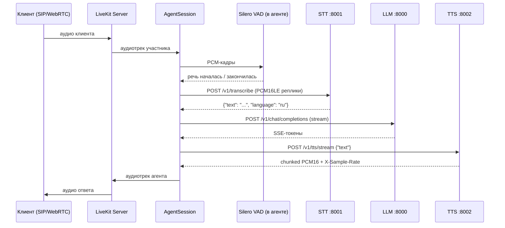

# Caller — LiveKit-агент исходящего обзвона

Агент на LiveKit Agents: подключается к комнате LiveKit (SIP/WebRTC), ведёт
исходящий разговор с клиентом голосом. Модельные сервисы — **LLM, STT и TTS** —
запускаются отдельно (проект `sporbita/voice-agent`, папки `llm/`, `stt/`,
`tts/`); агент обращается к ним по HTTP и не управляет их процессами.

```
Клиент (SIP/WebRTC) ⇄ LiveKit Server (VPS)
                          ⇅ wss://
                     Агент (этот репозиторий)
                          ├─ HTTP → LLM  :8000  (vLLM, OpenAI API)
                          ├─ HTTP → STT  :8001  (GigaAM-v3)
                          └─ HTTP → TTS  :8002  (ESpeech-TTS)
```

## Что делает агент

- Проверка связи → представление → квалификация интереса → передача менеджеру.
- Скриптовая фаза (проверка связи, интро) произносится напрямую через TTS;
  LLM в ней молчит (`_IntroAgent` + `StopResponse`).
- Дальше диалог ведёт LLM по промпту `agent/prompt.py` (имя — «Данил Назаров»,
  магазин «опт-ту-би»).
- Запись разговора: скрытый участник-рекордер микширует треки в WAV
  (`agent/recorder.py`, `RECORDINGS_DIR`).
- Исходящий набор: `ctx.add_sip_participant` по `SIP_OUTBOUND_TRUNK_ID`;
  номер передаётся в метаданных джоба (`agent/dial.py`).

## Как агент использует сервисы

| Сервис | Метод | Назначение |
|---|---|---|
| STT | `POST /v1/transcribe?sample_rate=16000&channels=1` (raw PCM16LE) | распознавание реплики клиента после VAD |
| STT | `GET /health` | проверка при отладке |
| LLM | `POST /v1/chat/completions` (`stream=true`) | генерация ответа на реплику |
| LLM | `GET /v1/models`, `GET /health` | проверка при отладке |
| TTS | `POST /v1/tts/stream` `{"text": "..."}` | озвучка фразы; ответ — chunked PCM16 mono + `X-Sample-Rate` |
| TTS | `GET /health` | проверка при отладке |

Один ход диалога:



Особенности:

- **VAD живёт в агенте** (плагин `livekit-plugins-silero`), STT-сервис батчевый:
  получает готовую реплику и возвращает финальный текст.
- **LLM отвечает потоком**; LiveKit режет текст на предложения и отправляет их
  в TTS по одному. Параметры запроса: `temperature=0.6`,
  `max_completion_tokens=120`, thinking выключен.
- **TTS синтезирует фрагмент целиком** до первого байта: задержка ответа равна
  времени синтеза первой фразы.
- Сервисы не запускаются агентом: адреса берутся из `.env`. Агент переживает
  их перезапуски (во время недоступности LLM ответы не генерируются).

## Структура репозитория

```
agent/                  # код агента: main.py, prompt.py, recorder.py,
                        # local_plugins/{stt,tts}.py, dial.py, requirements.txt
deploy/
  agent-node/           # установка и supervisor ТОЛЬКО агента
  livekit/              # LiveKit Server + SIP на VPS (+ локальный стенд)
  asterisk/             # тестовая АТС / шлюз BATC
  batc/                 # интеграция Exolve BATC
scripts/batc.py         # создание SIP-сотрудника BATC
docs/rest_api.pdf       # Exolve CRM API
```

Модельных сервисов здесь нет — они живут в отдельном проекте
`sporbita/voice-agent` (`llm/`, `stt/`, `tts/`).

## Запуск

- Агент: `deploy/agent-node/README.md` (venv, supervisor, `.env`).
- LiveKit: `deploy/livekit/README.md` (VPS, TLS/WSS, SIP, локальный стенд).
- Телефония: `deploy/batc/README.md`, `deploy/asterisk/`.

## Переменные окружения агента

| Переменная | По умолчанию | Назначение |
|---|---|---|
| `LIVEKIT_URL` | — | `wss://` адрес LiveKit |
| `LIVEKIT_API_KEY` | — | ключ LiveKit |
| `LIVEKIT_API_SECRET` | — | секрет LiveKit |
| `LLM_BASE_URL` | `http://127.0.0.1:8000/v1` | OpenAI-совместимый LLM |
| `VLLM_API_KEY` | `EMPTY` | Bearer-ключ к LLM |
| `LLM_MODEL` | `qwen3-14b` | имя модели в запросах |
| `STT_BASE_URL` | `http://127.0.0.1:8001` | адрес STT-сервиса |
| `TTS_BASE_URL` | `http://127.0.0.1:8002` | адрес TTS-сервиса |
| `AGENT_NAME` | `sales-agent` | имя воркера для dispatch |
| `SIP_OUTBOUND_TRUNK_ID` | — | транк исходящих звонков |
| `SIP_ANSWER_TIMEOUT` | `60` | ожидание участника после набора |
| `CONNECT_CHECK_TIMEOUT` | `8` | ожидание ответа на проверку связи |
| `RECORDINGS_DIR` | `/workspace/caller/recordings` | каталог записей |
| `LOG_LEVEL` | `INFO` | уровень логов |

Шаблон — `deploy/agent-node/env.agent.example`.
